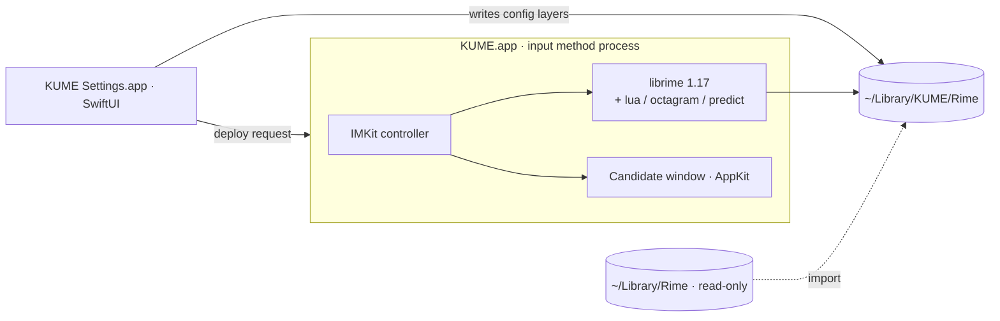

<p align="center">
  <picture>
    <source media="(prefers-color-scheme: dark)" srcset="assets/brand/kume/base-v1/lockup-white.png">
    
  </picture>
</p>

<p align="center"><b>New words, freely yours.</b></p>

<p align="center">An open-source Chinese input method for macOS, built on RIME · local first · optional AI</p>

<p align="center">
  <a href="https://aime.zool.app/en/">Upstream website</a> ·
  <a href="https://github.com/wangsizhu0504/kime/releases">Download</a> ·
  <a href="https://aime.zool.app/en/docs/">Upstream docs</a> ·
  <a href="docs/privacy.md">Privacy</a> ·
  <a href="README.md">中文</a>
</p>

<p align="center">
  <a href="https://github.com/wangsizhu0504/kime/actions/workflows/ci.yml"></a>
  <a href="https://github.com/wangsizhu0504/kime/releases"></a>
  <a href="LICENSE"></a>
  
  
  
</p>

> [!IMPORTANT]
> **KUME · 酷米输入法** is a renamed derivative of [AIME](https://github.com/zoolapp/aime), with upstream copyright and licenses preserved. It uses separate application identifiers and `~/Library/KUME/Rime`; existing AIME data is untouched. Build from source for now: KUME distribution signing, notarization, Homebrew packaging and update services are not configured. See [the rename notes](docs/renaming.md).

## Some words are better typed in quiet

Voice input is useful. So is a keyboard: when you do not feel like speaking, when you share a space, or when you want to think as you write and take your time with a sentence.

KUME is built for those moments. It keeps RIME's openness and flexibility, adds native controls for your typing habits, and brings in AI when you ask. There are no built-in ads; everyday input is processed on your Mac, and you choose your schemas, appearance and vocabulary.

If you want to keep full or double pinyin and your own word lists while editing fewer configuration files, or value quiet writing and control over your tools, give KUME a try.

## Why KUME

| | |
|---|---|
| **Open source, built on RIME** | Powered by [librime](https://github.com/rime/librime) with [rime-ice](https://github.com/iDvel/rime-ice) as the default schema. Reads your existing RIME configuration and imports from Squirrel read-only. KUME's own code is MIT-licensed. |
| **Everyday typing is processed on your Mac** | Composition, candidates and learned frequencies stay local: no input logs, built-in ads, telemetry or crash reporting. Snippets and optional input statistics are stored only on the Mac. |
| **AI when you ask for it** | Translate, polish or run your own prompts — hold ⌥, press Space, done at the cursor. Only the text you choose is processed, by the custom OpenAI-compatible endpoint and model saved in settings. Simplified/Traditional conversion runs locally. |
| **Typing habits you can adjust** | Visual settings for schemas, colours and shortcuts; a native candidate window, snippet categories, phrase codes and a symbol board picked by letter keys keep everyday tasks at the keyboard. |
| **Fresh vocabulary, an open ecosystem** | Official feeds support daily, weekly or manual checks and verify versions and SHA-256 before use. Subscribe to RIME-compatible word lists, install community schemas and import from Squirrel read-only. Credit goes to upstream maintainers and contributors. |

## Features

- **Quick menu** — hold ⌥ while typing: Space opens AI actions, 1–4 open snippets, symbols, frequent words and emoji, and 0 opens settings; no mouse needed.
- **Emoji board** — 1,906 offline emoji in nine categories. Digits switch categories, letters select cells, Shift+letter or Space keeps the board open, Return inserts and closes, and Esc goes back.
- **AI actions** — translate, polish, convert or run custom actions (e.g. Cantonese) on the selection, the text just typed, or the candidate being composed; results appear as candidates and Return replaces the text.
- **Draft layer (optional)** — typed text waits at the cursor until Return, so a whole sentence can be polished before it is sent.
- **Visual settings** — 80+ options covering everyday RIME configuration: candidates, Chinese/English switching, fuzzy pinyin, shortcuts, Traditional output, per-app defaults ([research notes](docs/rime-config-reference.md)).
- **Appearance** — colour scheme gallery with live preview, fonts, horizontal or vertical layout, radii and spacing, custom schemes with contrast warnings.
- **Vocabulary** — an official online catalogue (versioned, SHA-256 verified, daily or weekly updates), any RIME-compatible word list, and one-click schema packages (rime-ice, Wanxiang, rime-frost) with conflict warnings.
- **Sentence scoring (optional)** — download the approximately 405 MB Wanxiang offline language model from Vocabulary, then enable it in typing settings. Disabled by default; scoring stays on the Mac.
- **Snippets and phrases** — categorised snippets (phone, email, address…) and a table editor for custom phrases.
- **Input statistics (optional, local only)** — daily characters, hours and apps, frequent words you can pin.
- **Sync and backup** — merge learned frequencies across Macs through a RIME sync folder; export and restore a local backup file. KUME runs no sync server.
- **Automatic updates** — disabled until KUME has its own release service. Upstream AIME installers are rejected.
- **First-run guide** — from enabling the input method to choosing full or double pinyin and trying sample phrases, step by step.
- **CLI** — `kume deploy / bench / doctor / import-squirrel / package / get / set / sync` for scripting and CI.

## Install

### Build from source

The app runs on Apple silicon and Intel Macs; the `kume` CLI is Apple silicon only for now.

Building from source requires macOS 26+, Xcode 26+ and [XcodeGen](https://github.com/yonaskolb/XcodeGen) (`brew install xcodegen`).

```bash
git clone https://github.com/wangsizhu0504/kime.git kume && cd kume
bash scripts/install-dev.sh
```

The script downloads and verifies pinned librime and rime-ice releases, builds the input method, the settings app and the CLI, installs to `~/Library/Input Methods/KUME.app` and registers it.

## Migrating from Squirrel

1. Run "Sync user data" once in Squirrel so the frequency snapshots are current.
2. In KUME Settings, choose Import on the Overview page, or use the CLI:

   ```bash
   ~/Library/Input\ Methods/KUME.app/Contents/Helpers/kume import-squirrel --dry-run   # preview
   ~/Library/Input\ Methods/KUME.app/Contents/Helpers/kume import-squirrel
   ```

The import is read-only — `~/Library/Rime` is never modified. Your `*.custom.yaml` files are kept as they are in `~/Library/KUME/Rime/kume/imported/`; changes made in the app live in a separate layer that takes precedence and can be reset at any time.

## Architecture



The settings app does not link librime; it reads and writes files and asks the input method to redeploy through distributed notifications. Every setting is composed from three layers: KUME defaults → hand-written patches → changes made in the app. See [Architecture](docs/architecture.md) and the [decision records](docs/decisions/).

## Development

```bash
bash scripts/fetch-librime.sh && bash scripts/fetch-dicts.sh
swift build --package-path Packages/KUMEKit && bash scripts/stage-plugins.sh
swift test --package-path Packages/KUMEKit
xcodegen generate && open KUME.xcodeproj
```

Performance gate: `kume bench --schema rime_ice --keys nihaoshijie --iterations 2000 --assert-p99-ms 5`.
See [CONTRIBUTING.md](CONTRIBUTING.md) for contributing, [docs/releasing.md](docs/releasing.md) for releases, and report security issues privately as described in [SECURITY.md](SECURITY.md).

## Documentation and participation

The [documentation index](docs/README.md) collects usage, configuration, development and distribution guides. Report reproducible problems in [Issues](https://github.com/wangsizhu0504/kime/issues), read the [contribution guide](CONTRIBUTING.md) for code changes, and contribute public word lists to [aime-dicts](https://github.com/zoolapp/aime-dicts). Share schemas, themes and typing habits using synthetic examples; keep personal word frequencies and full configuration directories out of reports.

## Privacy

Input is processed on your Mac; KUME writes no input logs, never uploads pinyin, candidates or learned frequencies, and ships no analytics or crash-reporting SDKs. Subscribed online vocabularies are fetched from their public URLs at the interval you choose; KUME update checks are not enabled.
Text reaches an AI model only when you run an AI action. Configure your own endpoint, model and API key in settings and explicitly allow it to receive input-action text. The provider may charge for requests. See [Privacy](docs/privacy.md).

## Roadmap

- [x] librime frontend, candidate window, CLI, developer install and CI
- [x] Visual settings, appearance preview, per-app options, snippets and custom phrases
- [x] Official online vocabulary catalogue, schema packages (pinned versions, SHA-256)
- [x] Quick menu, AI actions (custom provider), draft layer
- [x] Input statistics, first-run guide, local backup and restore
- [ ] Configure KUME Developer ID signing, notarization and automatic updates
- [ ] Vertical text orientation, candidate paging indicator
- [ ] Reproducible librime builds from source

## Contributors

Thanks to everyone who helps build AIME: anyone who has opened a pull request or an issue is listed here.

**Code**

<p>
<a href="https://github.com/foru17" title="@foru17"></a>
<a href="https://github.com/miantiao-me" title="@miantiao-me"></a>
</p>

**Feedback and ideas**

<p>
<a href="https://github.com/BlackCCCat" title="@BlackCCCat"></a>
<a href="https://github.com/liustar2011-afk" title="@liustar2011-afk"></a>
<a href="https://github.com/ShingmoYeung" title="@ShingmoYeung"></a>
<a href="https://github.com/uu-myheart" title="@uu-myheart"></a>
<a href="https://github.com/gaoyuanzong" title="@gaoyuanzong"></a>
<a href="https://github.com/sunpm" title="@sunpm"></a>
<a href="https://github.com/liuhao320" title="@liuhao320"></a>
<a href="https://github.com/txchen" title="@txchen"></a>
<a href="https://github.com/morigith" title="@morigith"></a>
</p>

## Acknowledgements

[RIME / librime](https://github.com/rime/librime) · [Squirrel](https://github.com/rime/squirrel) · [rime-ice](https://github.com/iDvel/rime-ice) · [rime_wanxiang](https://github.com/amzxyz/rime_wanxiang) · [rime-frost](https://github.com/gaboolic/rime-frost) · [rime-essay](https://github.com/rime/rime-essay) · [OpenCC](https://github.com/BYVoid/OpenCC) · [Yams](https://github.com/jpsim/Yams)

## License

KUME's original code is released under the [MIT License](LICENSE). The installer also contains GPL-3.0 components — the native `librime-octagram` plugin and the rime-ice schemas, word lists and Lua scripts —
so **the installer as a whole is distributed under the terms of GPL-3.0**, while the original source stays MIT (MIT is GPL-compatible). Every release ships the corresponding source archive.
Upstream AIME word lists are CC BY 4.0. Other third-party components are listed in [THIRD_PARTY_NOTICES.md](THIRD_PARTY_NOTICES.md), and the native plugin licence review is in [docs/native-plugin-license-audit.md](docs/native-plugin-license-audit.md).

<p align="center"><sub>Based on AIME by ZOOL LLC / Luo Lei, with upstream copyright and licenses preserved. KUME / 酷米输入法 is the name of this derivative project.</sub></p>
